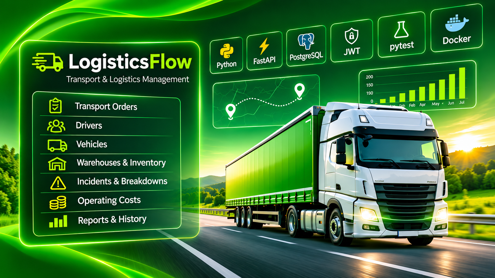

# LogisticsFlow



**LogisticsFlow** is a backend application for transport and logistics management.

The system is designed to support FTL (Full Truck Load) and LTL (Less Than Truckload) operations, including transport orders, cargo, drivers, vehicles and route management.

The project combines practical logistics knowledge with backend development using Python.

## Technology Stack

- Python 3.10
- FastAPI
- PostgreSQL
- SQLAlchemy
- Alembic
- Pydantic
- Pytest
- Git

## Current Implementation

The project currently includes:

- FastAPI application with a health check endpoint
- PostgreSQL database integration
- SQLAlchemy ORM models:
  - Customer
  - Address
  - RouteDistance
- Database migrations using Alembic
- Database relationships and constraints
- Separate test database configuration
- Automated tests using Pytest
- Project documentation

## Database Schema

The PostgreSQL database currently contains three tables:

| Table             | Description                                                                       |
| ----------------- | --------------------------------------------------------------------------------- |
| `addresses`       | Stores company addresses, address details and geographic coordinates              |
| `customers`       | Stores customer contact information, tax identification numbers and payment terms |
| `route_distances` | Stores distances and estimated travel durations between two addresses             |

### Database Relationships

- Each customer is associated with an address through a foreign key.
- Route distances reference two addresses using `address_a_id` and `address_b_id`.
- Unique constraints prevent duplicate address pairs.
- Check constraints prevent a route from referencing the same address as both endpoints.

### Route Distance Data

The `route_distances` table stores:

- Distance in kilometers.
- Estimated travel duration at 60 km/h.
- Estimated travel duration at 80 km/h.

Travel durations are stored as PostgreSQL `INTERVAL` values.

Database schema changes are managed using Alembic migrations.

## Planned Features

The planned development includes:

- Customer management (CRUD)
- Transport order management (CRUD)
- Cargo information management
- Multiple pickup and delivery points
- Driver and vehicle management
- Transport assignments
- Route distances and segments
- Transport status monitoring
- Transport event history
- Business logic validation
- Automated test coverage

## Project Structure

```text
LogisticsFlow/
├── alembic/
│   ├── versions/
│   └── env.py
├── app/
│   ├── models/
│   ├── schemas/
│   ├── routers/
│   ├── services/
│   ├── database.py
│   └── main.py
├── tests/
├── docs/
│   ├── images/
│   ├── PROJECT_REQUIREMENTS.md
│   ├── DATABASE_DESIGN.md
│   ├── ERD.md
│   └── DEVELOPMENT_PLAN.md
├── .env.example
├── .gitignore
├── alembic.ini
├── README.md
└── requirements.txt
```

## Documentation

Additional project documentation:

- [Project Requirements](docs/PROJECT_REQUIREMENTS.md)
- [Database Design](docs/DATABASE_DESIGN.md)
- [Entity Relationship Diagram](docs/ERD.md)
- [Development Plan](docs/DEVELOPMENT_PLAN.md)

## Installation

### 1. Clone the repository

```bash
git clone https://github.com/MarcinProgramista/LogisticsFlow-v2.git
cd LogisticsFlow-v2
```

### 2. Create and activate a virtual environment

```bash
python3 -m venv venv
source venv/bin/activate
```

### 3. Install dependencies

```bash
pip install -r requirements.txt
```

### 4. Configure the environment

Create a `.env` file based on `.env.example` and configure the PostgreSQL database connection.

### 5. Run database migrations

```bash
alembic upgrade head
```

## Running Tests

Run the automated test suite:

```bash
pytest
```

Tests use a separate test database configuration to avoid modifying development data.

## Project Status

**Development – MVP**

The application is being developed incrementally, with automated tests added alongside each feature.

The current focus is on building a reliable database foundation, implementing core data models and developing the business logic of the transport management system.

## Author

**Marcin Czapla**

Combining 20+ years of logistics experience with backend development in Python.
